  

  <strong>Artificial Intelligence Student · Python & Flask Development · Web & Graphic Design</strong>

  

## Profile

I am studying BS Artificial Intelligence at **Superior University** and building practical projects with **Python, Flask, HTML, and SQLite**. My interests also include web development and graphic design, while my current studies are expanding into **AI/ML** and **Generative AI**.

I’m currently open to internship opportunities where I can learn from experienced teams and contribute to real projects.

## Technical focus

  

**Application development:** Python · Flask · SQLite  
**Web and design:** HTML · Web development · Graphic design  
**Foundation:** Java basics

## Selected work

<table>
  <tr>
    <td width="100%" valign="top">
      01 / GENERATIVE AI
      <h3>ProtoGen AI</h3>
      
An AI game generator built with the Groq LLM.

      
<code>Generative AI</code> <code>Groq LLM</code>

      <a href="https://github.com/ruman-arshad/protogen-ai"><strong>Explore project →</strong></a>
    </td>
  </tr>
  <tr>
    <td width="100%" valign="top">
      02 / WEB APPLICATION
      <h3>Library Management System</h3>
      
A library management project developed with Python and Flask.

      
<code>Python</code> <code>Flask</code>

      <a href="https://github.com/ruman-arshad/Library-Management-system."><strong>Explore project →</strong></a>
    </td>
  </tr>
</table>

## Current direction

Learning AI/ML and Generative AI while continuing to improve my Python, Flask, and web development work through projects.

## Contact

The best place to reach me is [LinkedIn](https://www.linkedin.com/in/ruman-arshad-578b50407/).
